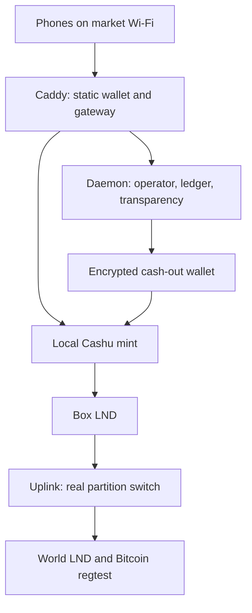

# Coupure

**Internet coupé. Marché ouvert.** A local Cashu mint keeps a market's payments moving when its internet uplink is cut. The signature demo: pay a seller, cut the WAN, pay again, then replay those exact coins at a second stall. The mint refuses the double-spend while the market's Wi-Fi still works.

Bitcoin **regtest** prototype for the Dakar Bitcoin Hack. The implementation is on `feat/complete-island-mvp` until reviewed and merged. No production-money or completed physical-pilot claim.

## Why a box in the market?

Senegal's mobile-data shutdowns interrupted commerce and mobile-money access. Contemporary reporting described [transfer disruptions](https://osiris.sn/Au-Senegal-comment-se-connecter.html) and [Wave's lack of USSD during the June 2023 cut](https://www.osiris.sn/La-coupure-de-l-internet-mobile-au.html). Wave later announced a USSD fallback; the problem is broader than one provider.

Offline bearer coins alone do not tell an isolated recipient whether a copy was spent elsewhere. Coupure keeps the mint reachable **inside** the disconnected market.

| Tier | Where | What the wallet promises |
|---|---|---|
| T1 | In range of the box, WAN up or down | A real local-mint swap before PAYÉ; spent inputs refused |
| T2 | Phone out of range | Required DLEQ, pinned keys, unseen proofs and a total 2,000 F CFA risk cap; provisional value stays unspendable |
| T3 | WAN returns | Signed, durable custodial withdrawals settle over Lightning; quote recovery prevents a second payment after response loss |

## Run the real demo

Needs Docker Compose v2.34+, Bash, `make`, `jq`, OpenSSL, `uv`, and Node 24. Docker Desktop must be running on macOS. Everything is self-hosted; no paid API key is required.

```bash
git clone https://github.com/rahulgunwanistudy-2005/Coupure.git
cd Coupure
git switch feat/complete-island-mvp
make demo
```

Open **http://localhost:8080/tour** for the walkthrough, **/op** for the operator console, and **/tableau** for the public board. Three independent wallets require separate devices/browser profiles. The operator PIN is generated in the private `.env`; session credentials stay in memory. `make env` adds missing settings without rotating existing secrets.

A public live URL and a recorded video still need to be supplied before submission. Full deployment, HTTPS and fresh-host instructions: [DEPLOYMENT.md](docs/DEPLOYMENT.md).

```bash
make test        # backend, wallet and durable-queue tests
make g0          # invoice paid and proofs issued over real regtest Lightning
make partition   # prove the cable actually breaks Lightning
make e2e         # browser: fund, pay, cut, replay refused, T2, queue, restore, settle
make sim         # real isolated workload → docs/METRICS.md and docs/metrics.json
make audit       # production dependency audits
make down        # stop; keep data
```

`make clean` deletes regtest volumes. Keep it away from anything containing value. For HTTPS inside the island, obtain a DNS-01 certificate while online and use `infra/compose.tls.yaml`; the phone must use its trusted hostname.

## Architecture



The mint's Postgres database is readable through a separate SELECT-only liabilities exporter. The public board labels its reserve basis as **Lightning channels only**, rejects stale snapshots and leaves missing values unavailable. Details: [ARCHITECTURE.md](docs/ARCHITECTURE.md).

## What is real and what is simulated

Real: Bitcoin Core regtest, both LND nodes, Nutshell, Postgres, browser cashu-ts, DLEQ verification, mint swaps, spent-proof rejection, encrypted vault/queue, and the TCP/network partition. No FakeWallet on the application happy path.

Explicitly **SIMULATED**: the outside-world faucet/receiving wallet and the periodic regtest miner. Their invoices and payments still use actual regtest Lightning channels. No real money is involved.

| Ecosystem component | Implemented use |
|---|---|
| Bitcoin / Lightning / LND | Real funding and reconnect settlement on regtest |
| Cashu / Nutshell / cashu-ts | Local ecash issuance, swaps, signature checks and recovery |
| BDK, Nostr, NWC | Deferred extensions; no integration claim |

## Security and verification

PIN-sealed browser vault; awaited deterministic counters; cross-tab revision checks; durable swap journals; an authenticated encrypted settlement wallet; scoped LND macaroons; operator login throttling; no third-party runtime origins; strict CSP and bounded request bodies.

Read [THREAT_MODEL.md](docs/THREAT_MODEL.md), [SECURITY.md](SECURITY.md), [VERIFICATION.md](docs/VERIFICATION.md) and the [exact scope/gates](docs/ROADMAP.md). The available local checks pass; real-stack CI, dependency-audit results and physical Android/TLS checks must be reviewed before declaring a release. No benchmark, visual audit or completed gate is fabricated.

## Honest limits

This v1 is custodial. A malicious or compromised mint/operator can steal or refuse redemption. The local hash chain is not an external solvency proof. T2 cannot detect a spend at a different isolated receiver until reconnection. First-use keyset pinning does not authenticate a fake first hotspot; trusted HTTPS and operator enrollment matter. HTTP fallback is a regtest convenience. A short PIN resists casual access, not offline forensic guessing. Normal routing-reserve rules and invoice expiry still apply to queued withdrawals.

The next steps are a supervised Dakar pilot, Garants-controlled cold reserves, independently signed attestations, least-privilege NWC sweeping and a federated custody design. See [ROADMAP.md](docs/ROADMAP.md). Pi build guide: [PI_BUILD.md](docs/PI_BUILD.md). Submission material: [DEMO_SCRIPT.md](docs/DEMO_SCRIPT.md), [DEVPOST.md](docs/DEVPOST.md), [SHARE_KIT.md](docs/SHARE_KIT.md). Upstream drafts are in `docs/upstream/` and have not been submitted.

Original development disclosure: [AI_USE.md](docs/AI_USE.md). MIT licensed.
