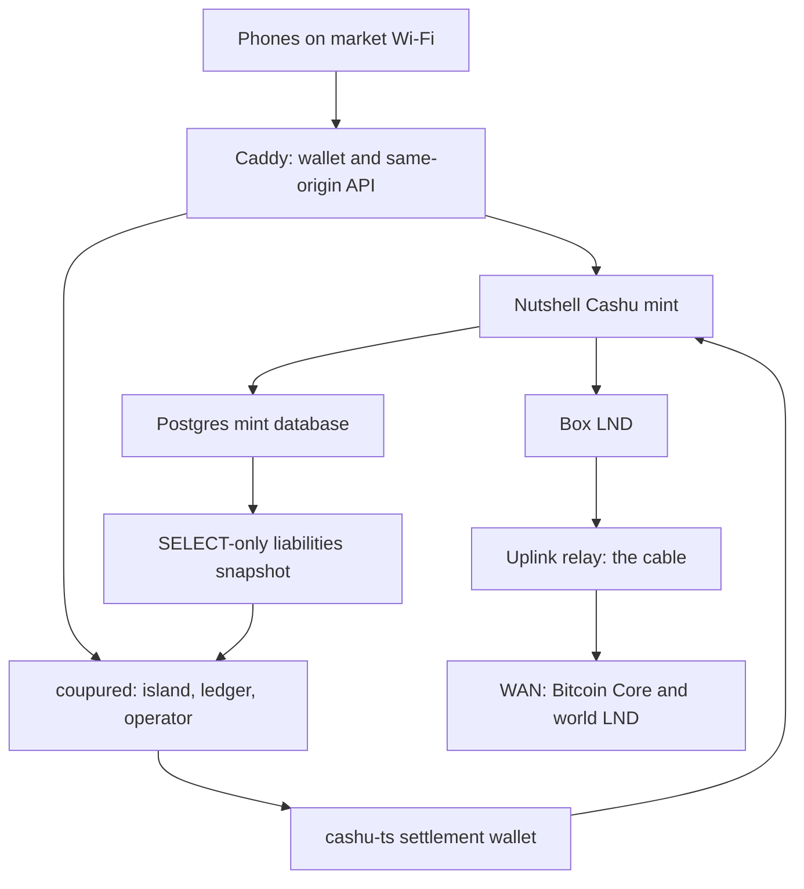

# How the island works

The phone needs the market Wi-Fi, but the Wi-Fi does not need an internet uplink. The mint is inside that network. When a seller receives a bearer token, it swaps those proofs at Nutshell before showing PAYÉ. The mint's own spent-proof constraints reject a replay at another stall.

`box` is an internal Docker network. Only the uplink relay also joins `wan`; Caddy separately joins an edge network to expose the LAN port. The uplink relay tears down connections and refuses new ones when cut, with nftables as defence in depth. The box's LND survives chain-backend loss. Local mint swaps continue without Lightning access.

| Path | Checks | Result |
|---|---|---|
| T1, phone reaches box | Local-mint swap; signature check; state subscriptions | Confirmed coins; copied input proofs cannot be accepted twice |
| T2, phone cannot reach box | Cached pinned keyset, required DLEQ, distinct/unseen Ys, sat unit, cumulative FCFA exposure cap | Provisional record; excluded from spendable balance; exact swap journal replay on return |
| T3, WAN returns | Active-channel recovery; signed queue identity; persisted melt quote; quote-state reconciliation | Lightning settlement; a lost PAID response cannot trigger another invoice |

The T2 cap defaults to 2,000 F CFA across **all** provisional receipts. A price must have been obtained from the box first; no price means no T2 acceptance. The EUR/XOF peg is represented as exact integers. The wallet pins the first successfully loaded mint keysets and does not silently add new ones. This is trust on first use, not a physical-sticker identity verification scheme.

## Custody and failure recovery

The settlement service uses the same pinned cashu-ts dependency as the browser, rather than a second implementation of blind-signature math. It has no published port and accepts only the daemon's bearer credential. The daemon authenticates operator actions separately; operator credentials never reach the mint.

A signed intention fixes the withdrawal ID, total amount, destination and creation time. The service durably saves deterministic counters and exact swap previews **before** making a swap. It acknowledges QUEUED only after the client's token has been swapped into the box's custody. Proofs, queue seed, pending previews and invoices are encrypted with AES-256-GCM. File replacement and parent directory are fsynced before acknowledgement.

An existing melt quote is checked before every retry. PENDING is never resubmitted and PAID is terminal. Expired quotes remain visible for review; they are not silently replaced. The signed amount is a maximum debit including fee reserve. NUT-08 blank change is disabled for unambiguous response-loss recovery: the mint keeps any unused routing reserve. Any separate change above invoice plus reserve is returned only on a claim signed by the same wallet identity, then swapped into the phone.

The browser also saves receive/send swap previews in its PIN vault. A failed response can be replayed through NUT-19 with the original outputs. IndexedDB revision compare-and-swap prevents two stale tabs from overwriting the vault. Before minting new deterministic outputs, counter reservations wait for the vault write.

## Transparency

The liabilities exporter uses `coupured_ro`, never the mint's database writer. It reads Nutshell's real `balance(keyset, balance)` view and atomically publishes a timestamped JSON file. The daemon sees a read-only volume. Snapshots older than 30 seconds are unavailable.

The board compares those liabilities with local Lightning channel balances only. It labels that basis and excludes on-chain/cold reserves. Missing data is `null`, never an invented zero. The append-only ledger records state changes and counts, with no token, invoice, name or phone number. Hash chains detect edits relative to a trusted head; they cannot stop an administrator from replacing the entire database and every local anchor.

## Offline application shell

SvelteKit builds static assets. The service worker precaches only the static shell and bundled assets. It never caches `/api` or `/mint`. Crypto uses noble primitives in both HTTP fallback and HTTPS contexts. Camera access, installation and service workers need a secure context; use the TLS overlay for a real LAN deployment.
